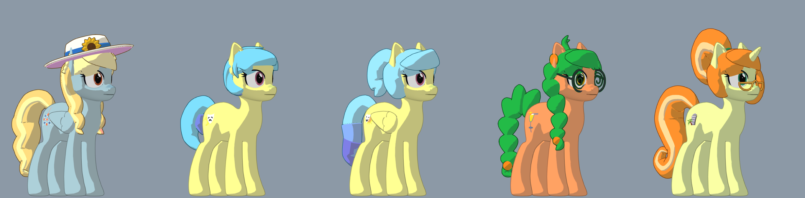

# Home: Equestria

A VR (and desktop) life-sim in Ponyville. Current version: **0.3.0-maredev** ([what's new](https://github.com/homedevanon/home-equestria/releases/tag/0.3.0-maredev)).

### Mare Fair mod

This fork adds the five [Mare Fair](https://marefair.org/mascots/) mascots to Ponyville as a free, unofficial fan mod. The mascots belong to Snowpity Inc.

**[Download Mare Fair 1.2.1](https://github.com/aptrtek/home-equestria/releases/tag/mare-fair-v1.2.1)**, then put `mare_fair.pck` in your mods folder (**Settings → Mods → Open mods folder**) and restart the game. See the [mod's README](mods/mare_fair/README.md) for full details.

What the mod changes:

- Adds Fair Flyer, Soirée, Matinée, Morning Mimosa and Fun Raiser as Ponyville residents, with their own bios, schedules, cutie marks and AI personalities.
- Gives each mare solid hair modelled from the official art. Fair Flyer has her sun hat, Morning Mimosa her spiral glasses and Fun Raiser her half-moon reading glasses.
- Parks a repainted copy of the town's balloon on Balloon Hill as their home. They take no houses, so nopony who lives in Ponyville is moved or has to share. Twilight's balloon is unchanged.
- Everything lives in `mods/mare_fair`, and the game runs as normal with the mod switched off.

### New here? Get the Universal Launcher

| System | Download |
|---|---|
| Windows | [HomeEquestria-Setup-windows.exe](https://github.com/homedevanon/home-equestria/releases/download/setup/HomeEquestria-Setup-windows.exe) |
| Linux | [HomeEquestria-Setup-linux.x86_64](https://github.com/homedevanon/home-equestria/releases/download/setup/HomeEquestria-Setup-linux.x86_64) (make it executable first: `chmod +x HomeEquestria-Setup-linux.x86_64`) |
| Quest standalone | The `quest.apk` from the [0.3.0-maredev release](https://github.com/homedevanon/home-equestria/releases/tag/0.3.0-maredev). Nothing else. |

Put the setup where you want the game, then open it. It installs into a `HomeEquestria` folder right next to itself (or press Change), downloads the newest version (about 3 GB), checks every file against the signed release, and can add a desktop shortcut. After that the game updates itself.

Windows may say "Windows protected your PC": press "More info", then "Run anyway".

### Already playing?

On 0.0.4-maredev or newer: press Update on the title screen or in the pause menu. On 0.0.3 or older: run the setup above.

### Other downloads

| You want to... | Download |
|---|---|
| Install by hand on Windows | Windows from MEGA, **or** both `windows.zip` parts from the [0.3.0-maredev release](https://github.com/homedevanon/home-equestria/releases/tag/0.3.0-maredev) |
| Install by hand on Linux | Linux from MEGA, **or** both `linux.tar.gz` parts from the [0.3.0-maredev release](https://github.com/homedevanon/home-equestria/releases/tag/0.3.0-maredev) |
| Edit the game from source | `Source code` (or clone the repo) **plus** all three `source-data` zips from the [0.3.0-maredev release](https://github.com/homedevanon/home-equestria/releases/tag/0.3.0-maredev), extracted into the repo root next to `project.godot` (they hold the ground, foliage and other generated data git leaves out) |

MEGA (0.3.0-maredev full game):
- Windows: https://mega.nz/file/ew5iCCKD#pEmlQocB4vMGgPBrI74qguZY5t_Nk5KW4S1pcvemPKI
- Linux: https://mega.nz/file/n0IVnBYQ#x2sykyHwCg3jbfud_bV6Mof3SovXXCiBcR1OcHkPrY4
- Quest: https://mega.nz/file/Ls5whYib#2wF7W34s1WqJ_ZGJ8FRbFyy7AnlqCgWqMOXvb_YhMEU

The release pages explain every file, how to join the two-part downloads and their SHA-256.

**Playing? Please also download `download-me` from the [0.3.0-maredev release](https://github.com/homedevanon/home-equestria/releases/tag/0.3.0-maredev).** It's a tiny file that does nothing; its download counter is the only way I can tell how many anons are playing from MEGA (MEGA has no counter). One click each, thank you!

Bug reports: https://scrumboy.com/1s42pi65 or https://github.com/homedevanon/home-equestria/issues
